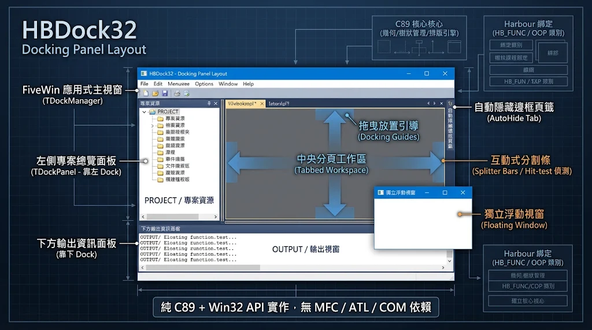

# HBDock32

Docking Panel para Harbour/FiveWin, estilo Visual Studio (paneles
acoplables con guías de arrastre, ventanas flotantes, autohide y
splitters), escrito en **C89 puro sobre Win32** — sin MFC, sin ATL,
sin dependencias de COM.

Compilado y probado con **Borland C++ 5.5** + **Harbour 3.2 Oficial**.

## Qué hace

- **Árbol de docking dinámico** (splits horizontales/verticales anidados),
  igual que el sistema de paneles de Visual Studio: acoplar un panel
  contra el borde de otro divide el espacio en dos.
- **Drag & drop real**: arrastrar un panel por su caption muestra las
  guías de acople (izquierda/derecha/arriba/abajo/centro) y un preview
  del destino; soltar fuera de cualquier guía lo convierte en ventana
  flotante independiente.
- **Splitters interactivos** entre paneles acoplados.
- **Autohide**: replegar un panel a una pestaña fina en el borde, que
  se expande temporalmente al pasar el mouse por encima.
- **Ventana contenedora autosuficiente** (`HBDOCKCONTAINERCREATE`): ya
  trae resuelto el mouse (drag, splitters, autohide) y el pintado del
  chrome de docking — no hace falta subclasear nada del lado FiveWin.
- **Capa de bindings Harbour** (`HB_FUNC`) más clases OOP estilo
  FiveWin (`TDockManager`, `TDockPanel`) para no tener que llamar
  funciones C sueltas desde tu `.prg`.



- **停靠面板與巢狀分割**：如左側的「專案總管」與下方的「輸出」視窗，透過**互動式分隔線（Splitters）**自由調整區塊大小。
- **拖放停靠引導（Drag & Drop Guides）**：拖曳面板時，畫面中央會出現上、下、左、右與中央分頁的停靠方位指示，放開滑鼠即可精準嵌入或合併為分頁群組。
- **獨立浮動視窗（Floating Window）**：將面板拖離停靠引導區，就會自動轉換為可自由移動的獨立浮動視窗。
- **邊緣自動隱藏（Auto-Hide Tab）**：不常用的面板可釘選收折至視窗邊緣，滑鼠移過時再暫時滑出展開。

## Estado del proyecto

En desarrollo activo. El árbol de docking, el drag & drop, los
splitters, el floating, el autohide y el pintado del chrome ya están
implementados y verificados (compila y enlaza limpio, 120 archivos
`.c`, 0 errores). Lo que todavía **no** está resuelto:

- Restauración exacta de posición al cancelar un drag a medio camino
  (se re-acopla al mismo lado, pero no a la posición exacta dentro
  del árbol).
- Persistencia de layout (guardar/restaurar la disposición de paneles
  entre sesiones).
- Undo/redo.
- Theming/skinning del chrome (por ahora usa los colores de sistema).

## Estructura del proyecto

```
include/            headers publicos (uno por modulo, muy granular)
src/
  core/              tipos base, listas, geometria
  dock/              panel, manager, arbol de docking, drag/float/autohide
  layout/            motor de layout, splitters, guias, hit-test
  window/            ventana flotante, tabs, temas de pintado
  container/         ventana hija autosuficiente (mouse + paint ya cableados)
  host/              integracion de mensajes Win32 (WM_LBUTTONDOWN, etc.)
  harbour/            capa de bindings HB_FUNC hacia Harbour
prg/                 clases TDockManager / TDockPanel (estilo FiveWin)
examples/            ejemplo completo de app FiveWin con 3 paneles
build_hbdock32.bat   script de build (bcc32 + tlib) -> hbdock32.lib
```

## Compilar

Editá las tres variables al principio de `build_hbdock32.bat`
(`BCC_DIR`, `HB_DIR`, `LIB_NAME`) y corré el script. Compila todo
`src\*.c` con `bcc32`, arma `hbdock32.lib` con `tlib`, e incluye la
capa de bindings Harbour si `HB_DIR` apunta a una instalación válida
(si lo dejás vacío, arma solo la librería C pura).

## Uso desde Harbour/FiveWin

```harbour
#include "hbdock.ch"

oDock := TDockManager():New( oWndMain, GetInstance() )

oPanel1 := TDockPanel():New( "PROJECT", "Project Explorer" )
oPanel1:SetWindow( oBrowseProject )
oPanel1:SetPreferredSize( 220 )
oDock:AddPanel( oPanel1 )
oDock:Dock( oPanel1, HBDOCK_LEFT )

oPanel2 := TDockPanel():New( "OUTPUT", "Output" )
oPanel2:SetWindow( oGetOutput )
oPanel2:SetPreferredSize( 150 )
oDock:AddPanel( oPanel2 )
oDock:Dock( oPanel2, HBDOCK_BOTTOM )

oWnd:bResized := {|nWidth, nHeight| oDock:Resize( nWidth, nHeight ) }
```

Ver `examples/hbdockdemo.prg` para un ejemplo completo y comentado
(tres paneles + botones para probar Float/DockBack/AutoHide en vivo).

## Licencia

GPLv3 — ver [LICENSE](LICENSE).
